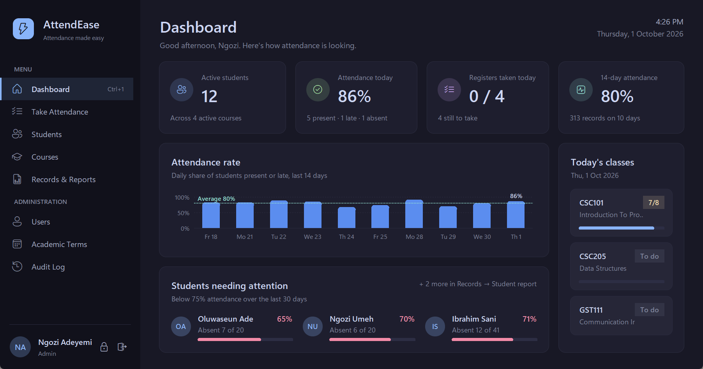
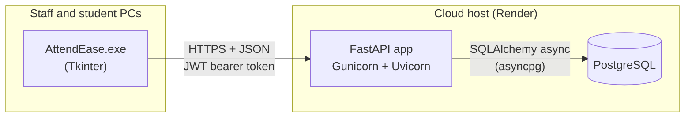
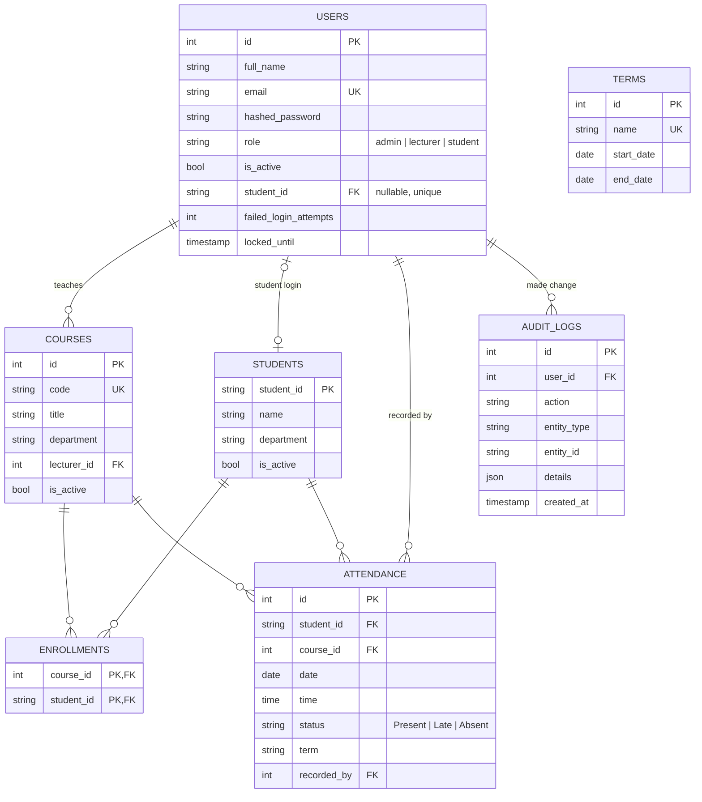
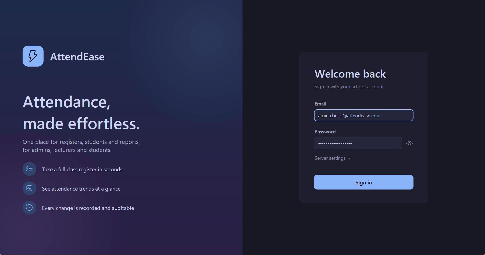
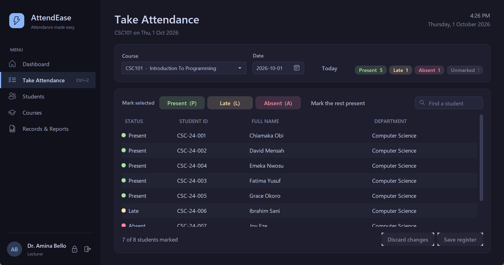
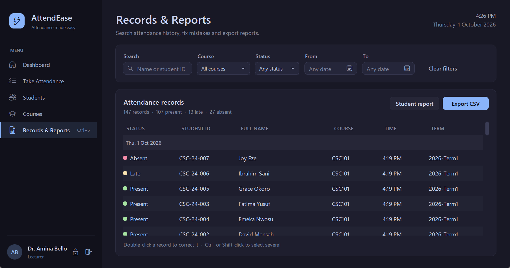
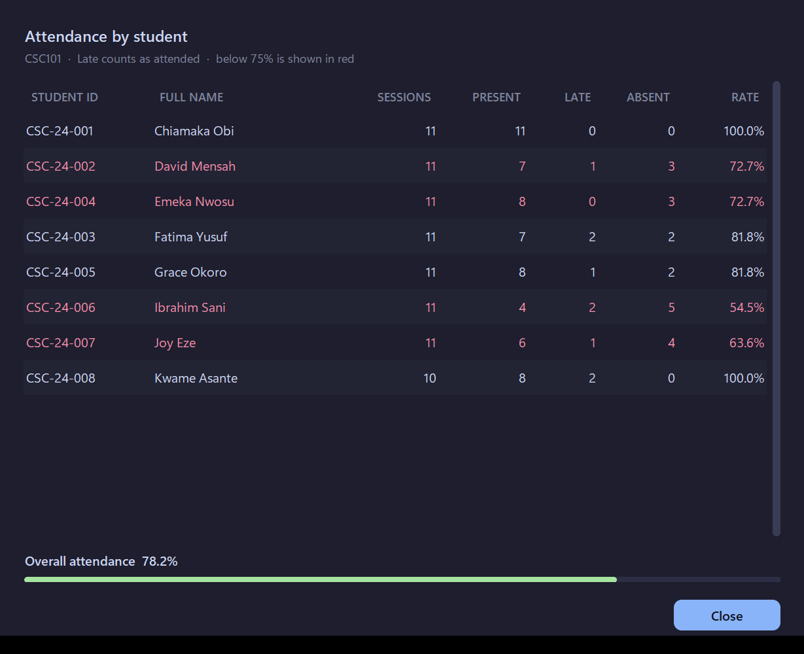
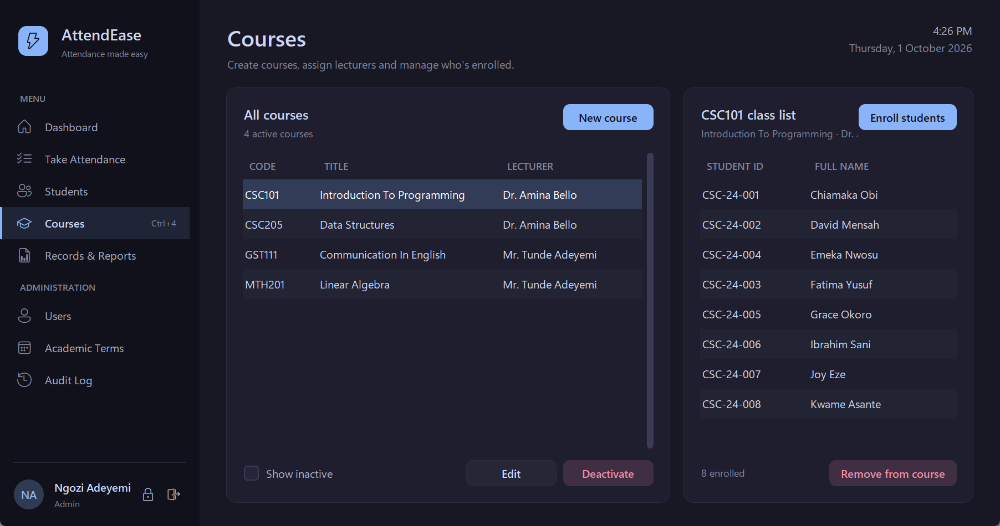
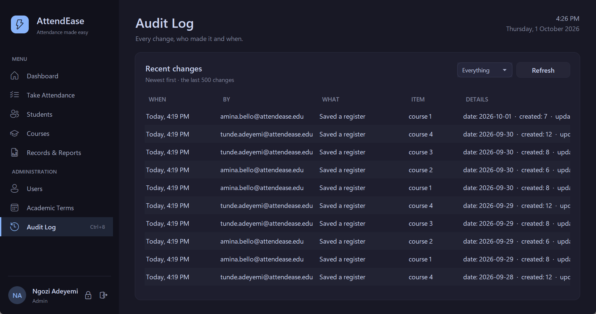
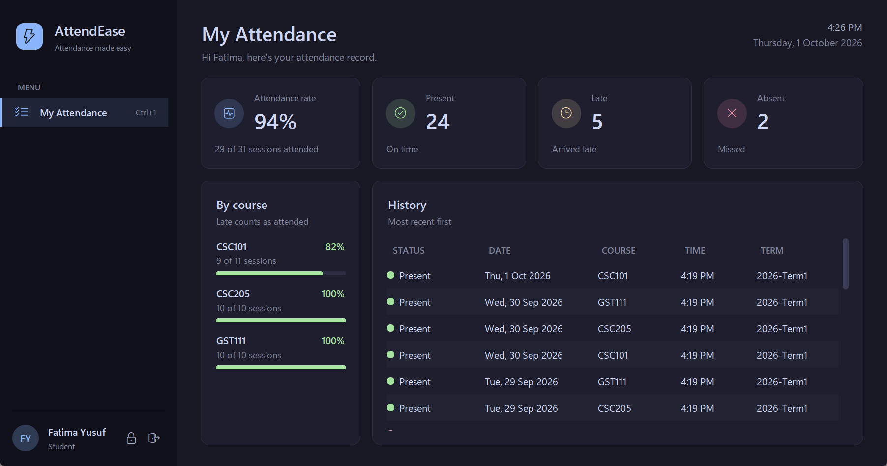

# AttendEase — Student Attendance Management System

AttendEase replaces paper attendance registers with a secure, central digital record.
Lecturers take a class register for each course in a few clicks. Administrators manage
students, courses, staff accounts and academic terms. Students can check their own attendance
history. Reports can be viewed on screen or exported to CSV.

The system has two parts:

- **Desktop client** (`attendease_client.py`, `client/`): a Windows app built with Tkinter,
  with a custom dark theme (rounded components drawn at start-up), sidebar navigation,
  a dashboard with an attendance chart, pop-up date pickers and toast notifications.
- **REST API** (`backend/`): FastAPI and PostgreSQL. It holds all data and enforces every rule.



## Features

- **Secure sign-in:** JWT authentication, bcrypt password hashing, and an account lockout after
  5 failed attempts. Users can change their own password.
- **Role-based access:**

  | | Admin | Lecturer | Student |
  |---|:-:|:-:|:-:|
  | Manage users, courses and terms; view the audit log | ✓ | | |
  | Register and edit students | ✓ | ✓ | |
  | Enroll students in courses | ✓ | own courses | |
  | Take registers, correct records | ✓ | own courses | |
  | Reports and CSV export | ✓ | own courses | |
  | Delete records, deactivate students | ✓ | | |
  | View own attendance | | | ✓ |

- **Automatic student IDs:** each new student gets an ID made from their department, the
  year and a number, such as `CS-26-0001`.
- **Class registers:** attendance is taken per course, per day. Mark students Present, Late or
  Absent, one at a time or in bulk (keys P, L, A), then save the whole register at once.
- **Data integrity:** a student can only be marked once per course per day, only when enrolled,
  and never for a future date. The database enforces this as well as the API.
- **Academic terms:** records are tagged automatically with the term their date falls in.
- **Dashboard:** today's attendance, registers still to take, a 14-day attendance-rate chart,
  and the students who need attention.
- **Reports:** attendance rate per student (below 75% is highlighted), filtered record
  history, and CSV export.
- **Audit log:** every change records who made it, what changed and when.
- **History is preserved:** students and courses are deactivated rather than deleted.

## Technology

**Frontend:** Python Tkinter (ttk), httpx, PyInstaller, Inno Setup

**Backend:** Python 3.12, FastAPI, Uvicorn, Gunicorn, SQLAlchemy 2.0 (async), asyncpg, Alembic,
Pydantic v2, pydantic-settings, PyJWT, passlib[bcrypt], OpenAPI/Swagger UI

**Database:** PostgreSQL 16+

**Quality and deployment:** pytest (tests run on SQLite and on PostgreSQL), Ruff, GitHub
Actions, Docker, Render

## Architecture



## Database design



`ATTENDANCE` has a unique constraint on `(student_id, course_id, date)`.

## Getting started

### 1. Run the backend

Follow [backend/README.md](backend/README.md). In short: create a PostgreSQL database, fill in
`backend/.env`, run `alembic upgrade head`, create the admin account, and start `uvicorn`.
The API docs are then at http://127.0.0.1:8000/docs.

### 2. Run the desktop client

```bash
python -m venv .venv
.venv\Scripts\python -m pip install -r requirements.txt
.venv\Scripts\python attendease_client.py
```

Sign in with the admin account. The client connects to `http://127.0.0.1:8000` by default.
To use another server, click **Server settings** on the sign-in screen. The address is
remembered for next time.

### 3. Build the Windows program and installer

```bash
.venv\Scripts\python -m pip install pyinstaller
.venv\Scripts\pyinstaller --noconfirm attendease_client.spec
```

This produces `dist\AttendEase.exe`. To make an installer, copy `config.json.example` to
`config.json`, set your server's address, and compile `installer.iss` with
[Inno Setup 6](https://jrsoftware.org/isinfo.php).

### 4. Deploy the backend

The repository includes a Render Blueprint (`render.yaml`). In the Render dashboard choose
**New → Blueprint** and select this repository. Render creates the database and the API, and
asks for `TIMEZONE` (for example `Africa/Lagos`), `FIRST_ADMIN_EMAIL` and
`FIRST_ADMIN_PASSWORD`. On start-up the server applies migrations and creates that admin account.
Put the resulting `https://….onrender.com` address in `config.json` before building the installer.

### Moving data from the old version

The first version stored data in a local SQLite file. To copy it into PostgreSQL:

```bash
cd backend
.venv\Scripts\python -m app.import_sqlite ..\attendance_system.db
```

The old version had no courses, so its records go into a course called `GENERAL`.

## Tests

```bash
cd backend
.venv\Scripts\python -m pytest
```

GitHub Actions (`.github/workflows/backend.yml`) runs lint, a migration round-trip check, and the
full test suite against PostgreSQL on every push.

## Screenshots

| | |
|---|---|
|  |  |
|  |  |
|  |  |
|  | |
